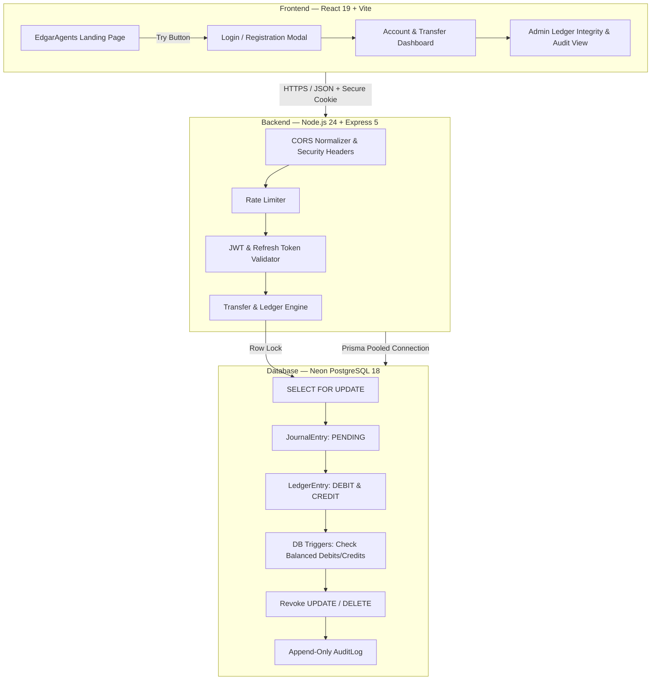

# BalanceVault — Provable Double-Entry Ledger Engine

[](https://nodejs.org)
[](https://react.dev)
[](https://vitejs.dev)
[](https://expressjs.com)
[](https://www.postgresql.org)
[](https://neon.tech)
[](https://www.prisma.io)

> **Money movement with a ledger you can prove.**  
> A high-performance, auditable double-entry accounting and transfer management platform engineered with database-level immutability triggers, deterministic row locking, and an EdgarAgents-inspired modern fintech interface.

---

## 🌐 Live Deployments & Endpoints

| Component | Provider | Live URL |
|---|---|---|
| **Frontend Application** | Vercel | [https://snovasysfrontend.vercel.app](https://snovasysfrontend.vercel.app) |
| **Backend API** | Render | [https://balancevault-api.onrender.com](https://balancevault-api.onrender.com) |
| **Database** | Neon Serverless | `aws-ap-southeast-1` (PostgreSQL 18.6) |
| **API Health Check** | Render | [https://balancevault-api.onrender.com/healthz](https://balancevault-api.onrender.com/healthz) |
| **API Readiness Check** | Render | [https://balancevault-api.onrender.com/readyz](https://balancevault-api.onrender.com/readyz) |

---

## 🛠️ Recent Improvements & Rectifications (AI-Assisted)

During continuous evaluation and code auditing, we identified and rectified several real-world fintech edge cases using AI:

1. **Standardized Currency to INR (₹)**
   - Switched frontend and backend from USD to **Indian Rupees (INR)**.
   - Formatted all amounts with Indian numbering locale (`en-IN`) and two-decimal paise precision (`₹1,000.00`).
   - Updated transfer forms and landing page cards to default to INR.

2. **Fixed Transfer Idempotency Key Regeneration**
   - *Issue Identified:* In the transfer form, the idempotency UUID was being regenerated on every input keystroke (`onChange`). If network dropped during submission, replay protection was lost.
   - *Fix:* Idempotency keys are now held stable across input changes and retries, regenerating strictly after a successful transfer or explicit form reset.

3. **Replaced Insecure `window.prompt()` in Admin UI**
   - *Issue Identified:* The onboarding rejection button used `window.prompt()`, which is blocked by modern browsers in iframes and poses security risks.
   - *Fix:* Built a clean inline rejection form inside the table with auto-focus, real-time reason validation, and Confirm/Cancel actions.

4. **Added Strict Non-Negative Balance Guard**
   - *Issue Identified:* `nextBalance()` in the money calculation library computed `current - amount` without an explicit guard before writing to ledger projections.
   - *Fix:* Added an explicit check throwing an `INSUFFICIENT_FUNDS` error if a debit would ever result in a negative balance.

5. **Strict Content-Type Validation (HTTP 415)**
   - Added middleware ensuring `POST`, `PATCH`, and `PUT` requests with payloads provide `application/json`, returning clean 415 errors instead of unhelpful 400 validation failures.

6. **Cleaned Typography & Mojibake Encoding**
   - Cleaned all corrupt character sequences (`—`, `↗`, `·`, etc.) across all React views so typography renders cleanly.

---

## 🚀 Key Problems Solved & Technical Highlights

### 1. Architectural Decoupling & Clean Monorepo Structure
- **Problem**: The codebase previously existed in a single monolithic nested folder with mixed dependencies and tight coupling.
- **Solution**: Completely restructured into independent, cleanly isolated **`backend/`** and **`frontend/`** workspaces coordinated via a root `package.json` npm workspace. Both services can be built, tested, and deployed independently or run concurrently via a single command.

### 2. Mathematically Guaranteed Double-Entry Ledger
- **Problem**: Traditional financial applications risk balance drift, single-sided journal writes, or ledger corruption when transactions fail midway.
- **Solution**:
  - Implemented an immutable double-entry journal model where every internal transfer produces two equal, simultaneous entries: one `DEBIT` to the source and one `CREDIT` to the destination.
  - Enforced by a **PostgreSQL database trigger** (`verify_journal`) that halts and aborts any transaction where `SUM(debits) != SUM(credits)`.
  - Stored `balanceAfterCents` snapshots and per-account monotonically increasing sequence counters.

### 3. Database-Level Immutability & Anti-Tamper Security
- **Problem**: Administrative users or compromised application credentials could retroactively alter or delete accounting and audit history.
- **Solution**:
  - Configured PostgreSQL triggers that block and abort any `UPDATE` or `DELETE` statement targeting completed `LedgerEntry`, `JournalEntry`, or `AuditLog` rows.
  - Applied strict least-privilege role separation (`deployment/runtime-privileges.sql`), explicitly revoking `UPDATE` and `DELETE` privileges from the application runtime role (`balancevault_app`).

### 4. Concurrency Safety & Idempotent Transfers
- **Problem**: Concurrent transfer attempts against the same accounts can induce deadlocks, race conditions, or duplicate charges.
- **Solution**:
  - Deterministic account row locking (`SELECT FOR UPDATE`) ordered by account UUIDs prevents deadlocks across parallel operations.
  - Client-supplied unique idempotency keys guarantee that network retries or duplicate button clicks replay the existing transfer receipt rather than creating duplicate journal entries.

### 5. Multi-Domain CORS & Cloud Environment Normalization
- **Problem**: Cross-origin requests between Vercel (`snovasysfrontend.vercel.app`) and Render (`balancevault-api.onrender.com`) failed due to trailing-slash URL discrepancies and Windows IPv6 (`::1`) proxy conflicts.
- **Solution**:
  - Hardened CORS middleware to dynamically normalize incoming origins and strip trailing slashes.
  - Explicitly bound Express listeners to `0.0.0.0` and normalized Vite development proxies to `127.0.0.1:4000`.
  - Configured `SameSite=none; Secure` cookie policies for cross-domain authenticated refresh tokens.

### 6. Cloud-Native Serverless Database Integration (Neon)
- **Problem**: Local Docker-based PostgreSQL databases are not reachable in production cloud deployments.
- **Solution**:
  - Linked and configured **Neon Serverless PostgreSQL 18** using dual connection channels:
    - **Pooled URL (`DATABASE_URL`)**: High-throughput transaction pooling via PgBouncer for API traffic.
    - **Direct URL (`DIRECT_URL`)**: Unpooled direct channel required for Prisma DDL migrations and advisory locks.
  - Automated cloud migration deployment and verified live data integrity via automated query scripts.

### 7. EdgarAgents-Inspired High-Converting Fintech Interface
- **Problem**: The original UI was a plain, functional utility dashboard with no marketing or introductory onboarding experience.
- **Solution**:
  - Built an interactive **Landing Page** inspired by **[try.edgaragents.com](https://try.edgaragents.com/)** featuring:
    - Signature color palette: **Cobalt Royal Blue** (`#002070`), **Midnight Black** (`#07162b`), **Electric Neon Cyan** (`#00e5ff`), and **Action Mint/Green** (`#3dec63`).
    - Top sticky header with the iconic angled polygon button: **`Try BalanceVault`** (`clip-path: polygon(0 0, 100% 0, 88% 100%, 0 100%)`) with dual-layer sliding hover animation.
    - "SEE FOR YOURSELF, FOR FREE" callout section with 1-click evaluator credential pills.
    - "HOW WE DELIVER" 4-pillar architectural showcase.
    - Seamless toggle between landing overview and authenticated workspace.

---

## 🔑 Demo Access & Test Accounts

You can test the live application at [https://snovasysfrontend.vercel.app](https://snovasysfrontend.vercel.app) using these pre-seeded accounts:

| Role | Email | Password | Starting Balance | Features to Test |
|---|---|---|---|---|
| **Administrator** | `admin@example.test` | `rukus-admin-password` | *N/A (Admin)* | Audit logs, Onboarding review, System-wide ledger integrity, Role management |
| **Demo User** | `demo@example.test` | `rukus_demo` | **₹1,000.00** | Internal money transfer, Idempotency replay, Personal ledger review |
| **Recipient** | `recipient@example.test` | `rukus_recipient` | **₹250.00** | Receiving transfers, Real-time balance updates |

*Note: You can also register a brand new identity directly in the UI. New accounts submit a simulated onboarding application that can be reviewed and approved by logging in as Admin.*

---

## 🏛️ Architecture Overview



---

## 📁 Repository Directory Map

```text
BalanceVault-reference-implementation/
├── backend/                        # Node.js + Express 5 API
│   ├── prisma/
│   │   ├── schema.prisma           # Prisma data model & dual-connection config
│   │   └── migrations/             # SQL migrations & database triggers
│   ├── src/
│   │   ├── config.mjs              # Validated environment configuration (Zod)
│   │   ├── app.mjs                 # Express app, middleware, routes, CORS
│   │   ├── server.mjs              # HTTP server, graceful shutdown
│   │   ├── routes/                 # Auth, accounts, transfers, ledger, admin, ops
│   │   ├── services/               # Double-entry ledger logic & row locking
│   │   └── scripts/                # Seed, migration, and verification scripts
│   └── package.json
│
├── frontend/                       # React 19 + Vite Frontend SPA
│   ├── src/
│   │   ├── LandingPage.jsx         # EdgarAgents-inspired landing page
│   │   ├── App.jsx                 # Workspace dashboard, transfer & admin pages
│   │   ├── api.js                  # Authenticated API client (cookie credentials)
│   │   └── styles.css              # Custom fintech design system
│   ├── vercel.json                 # Vercel SPA routing rewrites
│   ├── vite.config.js              # Vite bundler & development proxy
│   └── package.json
│
├── deployment/                     # SQL Privilege & Security Scripts
│   ├── runtime-privileges.sql      # Least-privilege table grants & immutability revokes
│   ├── dev-db-roles.sql            # Local development role bootstrap
│   └── bootstrap-role-setup.sql    # DBA pre-migration role setup
│
├── docker-compose.yml              # Local PostgreSQL 16 & Redis 7 container stack
├── .env.example                    # Documented template for environment variables
└── package.json                    # Monorepo root workspace coordinator
```

---

## 🛠️ Local Development Setup

### Prerequisites
- **Node.js 20+** (Tested on Node.js 24)
- **npm** (Windows PowerShell users: use `npm.cmd` if script execution is restricted)
- **Docker Desktop** (optional if using cloud Neon PostgreSQL)

### 1. Clone & Install Dependencies
```bash
git clone https://github.com/sampath-create/snovasys.git
cd snovasys
npm.cmd install
```

### 2. Configure Environment
Copy `.env.example` to `.env`:
```bash
cp .env.example .env
```
Ensure your `DATABASE_URL` and `DIRECT_URL` point to your Neon PostgreSQL database (or local PostgreSQL container).

### 3. Run Database Migrations & Seeds
```bash
cd backend
npm.cmd run db:migrate
npm.cmd run db:seed
cd ..
```

### 4. Start the Application
Run both backend and frontend concurrently from the root:
```bash
npm.cmd run dev
```
Or run them in separate terminals:
- **Backend**: `cd backend && npm.cmd run dev` (Runs on `http://localhost:4000`)
- **Frontend**: `cd frontend && npm.cmd run dev` (Runs on `http://localhost:5173`)

---

## 🚢 Production Deployment Instructions

### Backend (Render)
1. Create a **Web Service** on [Render](https://dashboard.render.com) connected to this repository.
2. Settings:
   - **Root Directory**: `backend`
   - **Build Command**: `npm install && npm run build`
   - **Start Command**: `npm start`
3. Environment Variables:
   - `NODE_ENV`: `production`
   - `DATABASE_URL`: Your Neon pooled connection string
   - `DIRECT_URL`: Your Neon direct connection string
   - `WEB_ORIGIN`: `https://snovasysfrontend.vercel.app` *(no trailing slash)*
   - `ACCESS_TOKEN_SECRET`: Random 32+ character secret
   - `COOKIE_SECURE`: `true`
   - `COOKIE_SAME_SITE`: `none`

### Frontend (Vercel)
1. Create a **New Project** on [Vercel](https://vercel.com) from the GitHub repository.
2. Settings:
   - **Root Directory**: `frontend`
   - **Framework Preset**: `Vite`
   - **Build Command**: `npm run build`
   - **Output Directory**: `dist`
3. Environment Variables:
   - `VITE_API_URL`: `https://balancevault-api.onrender.com`

---

## 🧪 Automated Deployment Verification
The codebase contains a built-in automated test suite that verifies the deployed environment end-to-end:
```bash
cd backend
npm.cmd run verify:deployment
```
The script performs live verification of:
- Public `/healthz` and `/readyz` endpoints
- Authentication token issuance & cookie rotation
- Ledger double-entry posting and balance consistency
- Deterministic transfer idempotency
