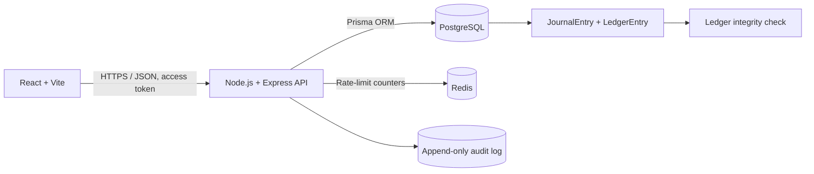

# BalanceVault

**Money movement with a ledger you can prove.**

> This ZIP is a standalone reference implementation package based on the supplied BalanceVault specification. The supplied GitHub URL (`Satwiksharan/balance-vault`) returned `404` through the connected GitHub account, so this work could not inspect or patch that repository. It is not represented as a verified modification of the linked project.

## Live demo

- Frontend: set `FRONTEND_URL` to the deployed React/Vite URL.
- API: set `API_BASE_URL` to the deployed Node API URL.
- This package does not contain verified deployment URLs or credentials. Do not publish credentials in this README or a public repository.

## Scope and safety

This application is a hackathon demonstration using synthetic data. It has no bank integrations, payment rails, KYC vendor, custody feature, or connection to real funds.

“This deployment is intended as a hackathon demonstration using synthetic data, not as a production financial service or a system for handling real funds.”

## Architecture



- `frontend/`: React user/admin interface. In local development, Vite proxies `/api`, `/healthz`, and `/readyz` to port `4000`.
- `backend/`: Express API, auth middleware, routes, services, tests, Prisma schema and migrations.
- `deployment/`: PostgreSQL runtime-role grants and local development role bootstrap SQL.
- PostgreSQL stores accounts, onboarding, refresh-token hashes, transfers, journal entries, ledger entries, and audit events.
- Redis is used for rate limiting when available. The API falls back to the Express in-memory rate limiter if Redis is unavailable at startup; readiness reports Redis as unavailable until it recovers.

## Features included

- Registration, login, logout, access-token authentication, refresh-token rotation, and hashed refresh-token storage.
- One-time first-admin bootstrap through a PostgreSQL `SECURITY DEFINER` function owned by a restricted `NOLOGIN` role.
- `USER` and `ADMIN` roles with server-side authorization checks.
- Synthetic onboarding flow: `DRAFT`, `SUBMITTED`, `UNDER_REVIEW`, `APPROVED`, and `REJECTED`.
- Account activation after onboarding approval.
- Ownership-scoped account, ledger, and transfer reads. Admin status does not override ordinary account ownership.
- Internal account transfer in integer cents, serializable transaction, deterministic account row locks, per-user idempotency key, and a balanced debit/credit journal.
- Per-account ledger sequence and `balanceAfterCents` snapshots.
- PostgreSQL triggers that prevent update/delete of completed journal entries, prevent mutation of completed ledger entries, and make audit logs append-only.
- Admin user search/status filter, role assignment, status changes, onboarding review, audit-log pagination/filters, and ledger integrity view.
- Structured JSON logs, request IDs, health/readiness endpoints, and graceful shutdown.

## Ledger model

Every successful internal transfer is performed in one database transaction:

1. The transfer idempotency key is checked for the authenticated user.
2. Source and destination account rows are locked in deterministic ID order.
3. The source owner and active account state are verified. The recipient must be an active user account.
4. A `PENDING` transfer and a `PENDING` journal entry are created.
5. Source and destination cached balances and per-account ledger versions are updated under the row locks.
6. Two equal-value entries are appended: one `DEBIT` to the source account and one `CREDIT` to the destination account.
7. The journal transitions to `COMPLETED`. A PostgreSQL trigger checks that total debit equals total credit.
8. The transfer is marked `COMPLETED`, and an audit event is appended.

For this owner-facing demo account model, `DEBIT` decreases an account's displayed balance and `CREDIT` increases it. The journal still requires equal debit and credit totals. `Account.currentBalanceCents` is only a cached value; the integrity endpoint recomputes account balances from ledger entries and verifies account sequence continuity and each stored `balanceAfterCents` snapshot.

A failed insufficient-funds attempt is persisted as `FAILED` without writing a journal or ledger entries. Replaying a completed idempotency key returns the original transfer rather than creating another journal.

## Security model

- Passwords are bcrypt-hashed with cost factor 12.
- Access JWTs are short-lived (default `10m`). Refresh tokens are random opaque values, stored only as SHA-256 hashes, and rotated on refresh.
- Refresh cookies are HTTP-only, `SameSite=Lax` by default, and secure in production. For separate-site frontend/API hosting, set `COOKIE_SAME_SITE=none`; the config forces secure cookies in that mode. Cookies are scoped to `/api/auth`.
- Login, registration, refresh, API, and bootstrap routes are rate-limited. Redis is used when reachable; in-memory limiting is a documented fallback.
- Login errors are generic; passwords, access tokens, refresh cookies, and bootstrap secrets are not logged.
- Admin routes are protected by current database roles, not trusted from client-supplied claims.
- Account, ledger, and transfer routes are scoped to the authenticated owner, including for admins.
- A restricted PostgreSQL role owns the bootstrap function. The app runtime role receives `EXECUTE`, not membership in the bootstrap role or PostgreSQL owner privileges.
- Runtime SQL grants deliberately omit `UPDATE`/`DELETE` on `LedgerEntry` and `AuditLog`. DB triggers add immutability checks for posted entries and journal records.

This is a demonstration codebase, not a security-certified banking system. Review the database grants, hosting configuration, cookie domain, TLS termination, secrets, backups, monitoring, and threat model before any real-world use.

## Environment variables

Copy `.env.example` to `.env` and replace all example secrets. The local Docker passwords are development-only.

| Variable | Purpose |
|---|---|
| `DATABASE_URL` | Restricted PostgreSQL runtime connection used by the API |
| `DIRECT_URL` | Migration-owner connection used by Prisma migrations only |
| `ACCESS_TOKEN_SECRET` | JWT signing secret; at least 32 characters |
| `ACCESS_TOKEN_TTL` | Access token lifetime, default `10m` |
| `REFRESH_TOKEN_DAYS` | Refresh-token lifetime, 1–30 days |
| `BOOTSTRAP_ADMIN_EMAIL` | First admin email |
| `BOOTSTRAP_ADMIN_PASSWORD` | First admin password (12+ characters) |
| `BOOTSTRAP_ADMIN_TOKEN` | Random one-time bootstrap request token (32+ characters) |
| `WEB_ORIGIN` | Exact browser origin allowed by CORS |
| `COOKIE_SECURE` | `true` for production HTTPS cookies |
| `COOKIE_SAME_SITE` | `lax` by default; use `none` with HTTPS when frontend and API are on separate sites |
| `REDIS_URL` | Redis URL for shared rate-limit counters |
| `API_BASE_URL` | API origin used by scripts |
| `FRONTEND_URL` | Frontend URL checked by deployment verification |
| `DEMO_ADMIN_EMAIL`, `DEMO_ADMIN_PASSWORD` | Seed admin identity; should match bootstrap identity |
| `DEMO_USER_EMAIL`, `DEMO_USER_PASSWORD` | Synthetic source account credentials |
| `DEMO_RECIPIENT_EMAIL`, `DEMO_RECIPIENT_PASSWORD` | Synthetic recipient account credentials |
| `VERIFY_DEMO_ADMIN_EMAIL`, `VERIFY_DEMO_ADMIN_PASSWORD` | Admin credentials used by deployment verification |

For production, create the `balancevault_app` LOGIN role, `balancevault_migrator`, and the `balancevault_bootstrap_operator` NOLOGIN role before migrating. Run `deployment/bootstrap-role-setup.sql` as a DBA to grant temporary function-owner membership to the migration role. For a custom API role name, update the migration grant target before applying it. Use unique high-entropy secrets from a secret manager, the restricted API login for `DATABASE_URL`, and a separate migration-only login for `DIRECT_URL`. Do not use the migration owner as the API runtime user.

## Local setup

Requirements: Node.js 20+, npm, Docker, PostgreSQL 16, Redis 7, and `psql` for applying grants.

1. Prepare environment:

   ```bash
   cp .env.example .env
   # Replace ACCESS_TOKEN_SECRET and BOOTSTRAP_ADMIN_TOKEN with independent random values.
   # Keep DEMO_ADMIN_EMAIL / DEMO_ADMIN_PASSWORD equal to the bootstrap admin values.
   ```

   Generate random values with `openssl rand -hex 32` (run it separately for each secret).

2. Start local PostgreSQL and Redis:

   ```bash
   docker compose up -d
   ```

   `deployment/dev-db-roles.sql` creates a migration role, a restricted runtime role, and a NOLOGIN bootstrap operator; it grants the migration role (not the API role) membership so it can transfer function ownership. The SQL file is intended only for a fresh local Docker volume.

3. Install dependencies and apply migrations:

   ```bash
   npm install
   npm run db:migrate
   ```

4. Grant the API runtime role its required table privileges:

   ```bash
   PGPASSWORD=local-migrator-change-me psql -h localhost -U balancevault_migrator -d balancevault -f deployment/runtime-privileges.sql
   ```

   On Windows PowerShell, set `$env:PGPASSWORD` to the local migration password before running the same `psql` command.

5. Start the API and React app:

   ```bash
   npm run dev
   ```

   - React: `http://localhost:5173`
   - API: `http://localhost:4000`
   - Health: `http://localhost:4000/healthz`
   - Readiness: `http://localhost:4000/readyz`

6. In a second terminal, bootstrap the first admin and seed demo data:

   ```bash
   npm run admin:bootstrap
   npm run db:seed
   ```

   The bootstrap command is safe to repeat: the first successful call creates the initial admin, and subsequent calls receive `409 Conflict` and exit without creating another administrator. The seed script creates two synthetic users and posts paired opening journal entries so the demo transfer flow has a funded source account. Seed output shows account numbers, never passwords.

7. Open the frontend and sign in with the values set in `.env`. Complete onboarding for newly registered users; an admin must approve the application before a user account is activated.

## API routes

| Method | Route | Access |
|---|---|---|
| `POST` | `/api/auth/register` | Public, rate limited |
| `POST` | `/api/auth/login` | Public, rate limited |
| `POST` | `/api/auth/refresh` | Refresh cookie, rate limited |
| `POST` | `/api/auth/logout` | Refresh cookie |
| `GET` | `/api/auth/me` | Authenticated |
| `POST` | `/api/onboarding` | Authenticated owner |
| `GET` | `/api/onboarding/status` | Authenticated owner |
| `GET` | `/api/accounts/me` | Authenticated owner |
| `GET` | `/api/ledger/me` | Authenticated owner |
| `POST` | `/api/transfers` | Authenticated account owner |
| `GET` | `/api/transfers/:id` | Transfer owner only |
| `POST` | `/api/admin/bootstrap` | One-time bootstrap token, only before first admin |
| `GET` | `/api/admin/users` | Admin |
| `PATCH` | `/api/admin/users/:id/status` | Admin |
| `PATCH` | `/api/admin/users/:id/roles` | Admin |
| `GET` | `/api/admin/onboarding` | Admin |
| `PATCH` | `/api/admin/onboarding/:id` | Admin |
| `GET` | `/api/admin/audit-logs` | Admin |
| `GET` | `/api/admin/ledger-integrity` | Admin |
| `GET` | `/api/admin/summary` | Admin |
| `GET` | `/healthz` | Public liveness |
| `GET` | `/readyz` | Public readiness |

Successful API responses use `{ success, data, error }`. Errors use `{ success: false, data: null, error: { code, message, details } }`.

## First-admin bootstrap and PostgreSQL roles

The second migration creates `balancevault_bootstrap_operator` as a `NOLOGIN` role and transfers ownership of `public.balancevault_bootstrap_admin(TEXT, TEXT)` to it. Its rights are limited to the user/role/audit tables needed for bootstrap. The function serializes concurrent calls with a PostgreSQL advisory transaction lock, checks that no admin exists, creates or promotes the configured user, writes the audit event, and rejects later calls.

Create the restricted API LOGIN role named `balancevault_app` and the `NOLOGIN` operator role before applying migrations. As a DBA, run `deployment/bootstrap-role-setup.sql` after creating `balancevault_migrator`; this explicitly grants membership to the migration role so it can transfer function ownership. The app runtime role must not be a member. The bootstrap migration grants the app role `EXECUTE` while the migration owner still owns the function, then transfers function ownership to the `NOLOGIN` operator role. Apply `deployment/runtime-privileges.sql` as the migration owner for the table grants. For a differently named API role, apply `deployment/grant-app-bootstrap.sql` as a PostgreSQL superuser/DBA or the current function owner. Do not grant the API role membership in `balancevault_bootstrap_operator`, `CREATEROLE`, or database/table ownership.

If PostgreSQL returns SQLSTATE `42501`, the API responds with `BOOTSTRAP_DATABASE_PERMISSION_MISSING` and instructs the operator to apply the grant script. The bootstrap secret is sent only in the `X-Bootstrap-Token` header, compared using a constant-time digest comparison, and never returned or logged.

## Tests

Fast unit tests:

```bash
npm test
npm run test:auth
npm run test:ledger
```

The database-backed transfer and HTTP integration tests are intentionally skipped unless explicitly enabled. Run them only against a disposable test database that already has the Prisma migrations applied. Run the bootstrap suite separately against a **fresh** test database with no admin user, because bootstrap is one-time:

```bash
# Set TEST_DATABASE_URL to an isolated database, not your live demo database.
RUN_DB_TESTS=true TEST_DATABASE_URL="postgresql://.../balancevault_test?schema=public" npm run test:e2e
RUN_DB_TESTS=true TEST_DATABASE_URL="postgresql://.../balancevault_test?schema=public" npm run test:ledger
# Use a separate, empty database for first-admin bootstrap.
RUN_DB_TESTS=true TEST_DATABASE_URL="postgresql://.../balancevault_bootstrap_test?schema=public" npm run test:bootstrap
```

For shells where environment assignment syntax differs, export `RUN_DB_TESTS` and `TEST_DATABASE_URL` before running npm. The test suite includes:

- Money parsing/formatting and role/ownership unit tests.
- First-admin bootstrap rejects invalid tokens, succeeds once, returns `409` on repeat, and supports admin login (fresh database required).
- Transfer balancing, insufficient funds, idempotency replay, ledger integrity tamper detection, and completed-entry immutability (database-backed when enabled).
- Registration/login, generic invalid-login errors, refresh rotation, logout revocation, onboarding state, and admin RBAC (database-backed when enabled).

## Deployment verification

Set `API_BASE_URL`, `FRONTEND_URL`, bootstrap variables, seeded demo credentials, and admin verification credentials. Seed the demo accounts before verifying transfer flow.

```bash
npm run verify:deployment
```

The script checks frontend reachability, `/healthz`, `/readyz` (database, migration table, and Redis), Prisma migration status, bootstrap response (`201` on first run or expected `409` after bootstrap), deployed admin login/RBAC, registration, onboarding submission and approval, refresh rotation/logout, internal transfer, ledger visibility, ledger integrity, and transfer audit-log creation.

A failed readiness check or a missing verification credential is reported as a failure; the script does not silently mark skipped checks as passed.

## Production deployment checklist

- [ ] Use HTTPS and `COOKIE_SECURE=true`.
- [ ] Configure `WEB_ORIGIN` to the exact deployed frontend origin.
- [ ] Keep `DATABASE_URL` on the restricted runtime role; use `DIRECT_URL` only for migrations.
- [ ] Apply Prisma migrations using the migration owner.
- [ ] Apply runtime grants; verify the API role is not a member of the bootstrap operator role and does not own database objects.
- [ ] Configure Redis and confirm `/readyz` reports all dependencies ready.
- [ ] Set independent secrets in a secret manager; never commit `.env`.
- [ ] Bootstrap once, then remove or rotate bootstrap credentials according to the hosting secret-management procedure.
- [ ] Seed only synthetic demo identities and balances.
- [ ] Run unit, database-backed, and deployment verification tests.
- [ ] Verify owner isolation, append-only triggers, and ledger integrity.
- [ ] Do not enable real payment, banking, KYC, custody, or real-funds functionality.

## Implementation status and file guide

See [`IMPLEMENTATION_STATUS.md`](IMPLEMENTATION_STATUS.md) for what was implemented, the exact checks run, and what remains unverified. See [`FILE_GUIDE.md`](FILE_GUIDE.md) for a file-by-file map of the package.

## Known limitations and honest status

- This is an independent reference package, not a patch to the linked GitHub repository. Existing files, current deployed environment variables, the actual admin bootstrap implementation, and live credentials could not be inspected because the linked repository returned `404` via the available GitHub connection.
- The package has not been installed with npm in this environment and has not been run against a PostgreSQL/Redis deployment. Dependency installation, Prisma generation, migrations, role grants, DB-backed tests, and browser flows remain to be executed by the project owner. The precise checks executed are listed in `IMPLEMENTATION_STATUS.md`.
- The React interface is a minimal evaluator-oriented demo. It does not include password reset, email verification, a full audit export, or production-grade operational controls.
- The initial source and recipient demo balances are synthetic seed entries, never real value.
- The API assumes the reverse proxy forwards HTTPS correctly and that the configured frontend and API origins are appropriate for the deployment.
- `/readyz` intentionally returns `503` while Redis is unavailable, even though the API can continue with in-memory rate limiting.
- The test integration suites are opt-in and require a disposable migrated database.

## AI-tool usage disclosure

This reference package was prepared with AI assistance from the written project specification. The developer/operator must review the implementation, run the documented tests, verify database permissions and deployment behavior, and take responsibility for any changes before demonstration.
